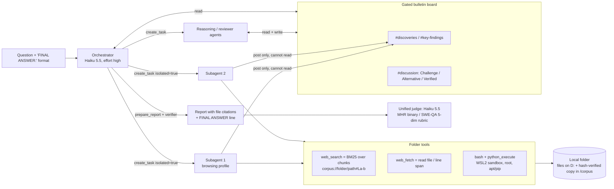

# ArcticSwarm for RAG over local folders (Claude Haiku 5.5)

This repo adapts the multi-agent deep-research framework [ArcticSwarm](https://github.com/Snowflake-AI-Research/ArcticSwarm) ([Yoon et al. 2026, arXiv:2609.01870](https://arxiv.org/abs/2609.01870)) from live-web research to **retrieval-augmented generation over a local folder of many files**:
- There is **no web search**.
- **Every agent runs on Claude Haiku 5.5.**
- Agents may run **arbitrary bash and Python over the files** inside an isolated Linux sandbox, and can install any tool or library.

The adaptation is evaluated with a [pre-registered](reports/preregistration.md) protocol on two benchmarks:
- [MultiHop-RAG](https://arxiv.org/abs/2401.15391): 609 news articles as files, multi-hop questions.
- [SWE-QA](https://arxiv.org/abs/2509.14635): repository-level code questions over real Python repos.

<!-- RESULTS:START -->
> Status (2026-11-18): the framework adaptation, harness and preregistration are done. The day-1 runs (main method M, then baseline B2, then an agent-count sweep) are in progress.
<!-- RESULTS:END -->

## How it works (short)
1. **Folder corpus backend.** A new `folder` backend in ArcticSwarm walks the folder, extracts text (code, markdown, PDF, DOCX…), and splits it into line-aligned chunks. It indexes them with BM25 ([bm25s](https://github.com/xhluca/bm25s)). Agents get:
   - `web_search`: BM25 over the folder.
   - `web_fetch`: read a file or line span by path, with paging.
   - Citations of the form `corpus://folder/<path>#L<a>-<b>`.
2. **Arbitrary code execution.** `bash` and `python_execute` run as root inside a dedicated WSL2 Ubuntu distro. It has no Windows drives, no Windows interop, no API keys, and a soft no-web proxy guard that still allows package installs. The corpus is copied there and hash-verified before each run.
3. **ArcticSwarm's orchestration is unchanged.** An orchestrator posts tasks to a gated bulletin board. Isolation-mode subagents research independently, and reviewers issue Challenge/Alternative/Verified verdicts before the report is committed.

## Architecture



## What happens when you run it
1. `folderrag prepare` materialises the corpora and writes the seeded, stratified 20-question sample to `data_eval/day1_sample.jsonl` plus one CSV per folder:
   - the 609 MultiHop-RAG articles as `.md` files
   - 4 SWE-QA repositories cloned at the benchmark's pinned commits
2. `folderrag run M` (swarm) or `folderrag run B2` (single agent) does the following for each folder:
   - Copies the folder into the WSL sandbox at `/corpus/...` and verifies its hashes.
   - Runs `arcticswarm-eval` with `ArcticSwarm/conf/bench/folder_rag.yaml`. The first query builds a BM25 index, which is cached under `D:\AI\arcticswarm-folder-rag\index`.
   - Agents search, read files and run code. The terminal shows a live per-question feed of tool calls and board posts.
   - Every LLM prompt delta and response is appended to `logs/llm_calls_*.jsonl`.
   - It re-checks the sandbox copy afterwards.
3. `folderrag judge` collects every answer, then scores it with the same Haiku 5.5 judge for all conditions. It also computes token cost, latency, tool usage and gold-evidence recall.
4. `folderrag analyze` regenerates `results/<tag>/metrics.json`, `tables.md` and the figures, using the pre-registered tests.

## Repository layout
- `ArcticSwarm/`: git submodule, the adapted framework (private copy, branch `folder-rag`).
- `src/folderrag/`: evaluation harness (datasets, sandbox, runs, judge, analysis).
- `scripts/probe_haiku.py`: API request-shape probe for Haiku 5.5.
- `reports/`: literature review, state of the art, preregistration, plan, experiment reports.

## Setup (Windows 11)
```powershell
git clone --recurse-submodules https://github.com/BurnyCoder/arcticswarm-folder-rag-research.git
cd arcticswarm-folder-rag-research
uv sync
```
Put `ANTHROPIC_API_KEY` and `ANTHROPIC_WORKSPACE_ID` in `.env`. Full instructions will follow once the harness is complete.

## License
Harness code is Apache-2.0, matching ArcticSwarm. The datasets keep their own licenses: MultiHop-RAG is ODC-By and SWE-QA is Apache-2.0.
