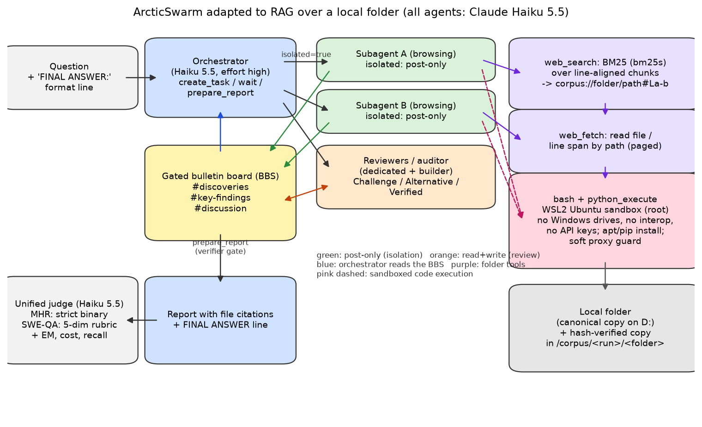
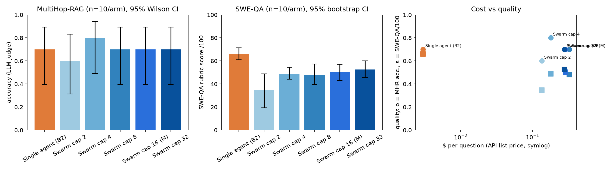
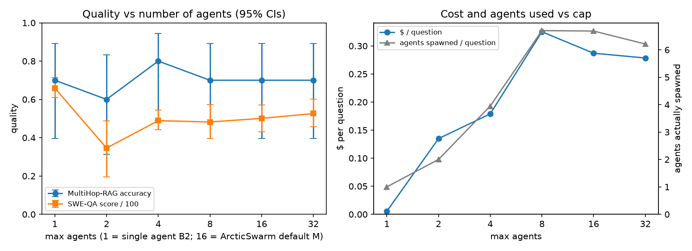

# ArcticSwarm for RAG over local folders (Claude Haiku 5.5)

**What this is.** This repo adapts [ArcticSwarm](https://github.com/Snowflake-AI-Research/ArcticSwarm) ([Yoon et al. 2026, arXiv:2609.01870](https://arxiv.org/abs/2609.01870)) to **retrieval-augmented generation (RAG) over a local folder of many files**, and evaluates the result with a pre-registered protocol. ArcticSwarm is a multi-agent "deep research" framework in which isolated subagents research in parallel and reviewers challenge their findings before a report is committed. Our version:
- has **no web search**
- runs **every agent on Claude Haiku 5.5**
- lets agents **run arbitrary bash and Python over the files** in an isolated Linux sandbox, where they can install any tool or library

**Motivation.** "Chat with your folder" (document collections, code repositories) is one of the most common RAG uses. ArcticSwarm's gains were shown on web-scale questions with obscure answers and frontier models ([paper](https://arxiv.org/abs/2609.01870)). We test whether its deferred-consensus orchestration also helps for small, closed folders with a small, cheap model and code-capable agents.

**Method.** Three main changes:
1. A new **folder corpus backend**: BM25 via [bm25s](https://github.com/xhluca/bm25s) over line-aligned chunks, with citable `path#Lstart-end` ids and file reads by path.
2. A **WSL2 sandbox execution backend** for `bash` and `python_execute`.
3. Claude Haiku 5.5 support and native-Windows fixes.

Evaluation (details in the [preregistration](reports/preregistration.md)):
- **Data:** a seeded, stratified, paired sample from [MultiHop-RAG](https://arxiv.org/abs/2401.15391) (news articles written as 609 files) and [SWE-QA](https://arxiv.org/abs/2509.14635) (repository questions over requests, flask, pytest and django at pinned commits).
- **Comparison:** the swarm against ArcticSwarm's own single agent with identical tools, plus an agent-count sweep.
- **Judging:** one Haiku 5.5 judge for all arms.

**Highlights (day 1, 20 questions per arm; exploratory, details below).**
- **Negative result.** The swarm did **not** beat the single agent.
  - MultiHop-RAG: equal accuracy, with identical per-question outcomes.
  - SWE-QA: the swarm scored significantly **lower** under the strict rubric, at a much higher cost and latency (exact figures in the Results section below).
- **Retrieval was not the bottleneck.** Both systems found the gold evidence files in almost every case.
- **Metric finding.** MultiHop-RAG's official word-overlap metric is gameable: a constant answer string scores higher than the best published MultiHop-RAG results we found (figure in the Results section below; see the literature review). We replicated this, so we score a forced `FINAL ANSWER:` line instead.
- **Engineering findings.** Stock ArcticSwarm:
  - crashes at import on native Windows
  - is rejected by Haiku 5.5's API (it sends `budget_tokens` thinking)
  - could send the Anthropic key to OpenAI in a fallback path

  All are fixed in the fork.
- **Novelty.** To our knowledge this is the first adaptation of ArcticSwarm to local-folder RAG with sandboxed arbitrary code execution, evaluated against its own single-agent harness under a preregistration.



<!-- RESULTS:START -->
## Results (day 1, 2026-11-18; exploratory, n = 20 paired questions per arm)

All numbers below are generated by `scripts/build_paper.py` from `results/day1/metrics.json`. The tables are the output of `folderrag analyze`.

| Condition | max agents | agents spawned / q | MultiHop-RAG acc. (judge) [95% CI] | EM | official overlap | evidence recall | SWE-QA score /100 [95% CI] | $/question | median latency (s) | tool calls / q | bash+python / q | errors | hit 900 s limit |
|---|---|---|---|---|---|---|---|---|---|---|---|---|---|
| Single agent (B2) | 1 | – | 70% [40%, 89%] (n=10) | 70% | 70% | 94% | 65.9 [61.1, 71.4] (n=10) | 0.005 | 16 | 7.2 | 4.2 | 0 | 0 |
| Swarm cap 2 | 2 | 2.0 | 60% [31%, 83%] (n=10) | 60% | 80% | 100% | 34.6 [19.4, 48.8] (n=10) | 0.135 | 1205 | 15.6 | 22.3 | 5 | 17 |
| Swarm cap 4 | 4 | 3.9 | 80% [49%, 94%] (n=10) | 70% | 100% | 100% | 48.9 [44.1, 54.5] (n=10) | 0.179 | 1205 | 31.6 | 31.8 | 0 | 12 |
| Swarm cap 8 | 8 | 6.7 | 70% [40%, 89%] (n=10) | 70% | 100% | 100% | 48.2 [39.5, 57.2] (n=10) | 0.325 | 354 | 122.3 | 48.6 | 0 | 1 |
| Swarm cap 16 (M) | 16 | 6.7 | 70% [40%, 89%] (n=10) | 70% | 90% | 100% | 50.1 [43.0, 57.0] (n=10) | 0.287 | 317 | 117.0 | 45.6 | 0 | 0 |
| Swarm cap 32 | 32 | 6.2 | 70% [40%, 89%] (n=10) | 70% | 100% | 100% | 52.6 [45.8, 60.1] (n=10) | 0.279 | 282 | 110.8 | 41.9 | 0 | 0 |

T0 trivial baselines on all 2556 MultiHop-RAG queries (no API calls):

| Trivial answer | official word-overlap metric | normalized EM |
|---|---|---|
| majority_per_type | 55.4% | 53.1% |
| constant_hedge | 85.6% | 30.6% |

Exploratory (post hoc): answer length and SWE-QA rubric dimensions (mean, 1-20 each):

| Condition | median answer chars (MHR / SWE-QA) | correctness | completeness | relevance | clarity | reasoning | cases with no search/code tool call |
|---|---|---|---|---|---|---|---|
| Single agent (B2) | 1868 / 3200 | 12.6 | 11.3 | 13.3 | 14.8 | 13.9 | 0 |
| Swarm cap 2 | 17719 / 22746 | 9.7 | 8.2 | 8.0 | 8.2 | 9.0 | 1 |
| Swarm cap 4 | 18105 / 16627 | 10.0 | 8.7 | 9.5 | 9.9 | 10.8 | 1 |
| Swarm cap 8 | 15978 / 18536 | 10.1 | 8.9 | 9.7 | 9.1 | 10.4 | 0 |
| Swarm cap 16 (M) | 16355 / 16972 | 10.8 | 9.4 | 9.3 | 9.8 | 10.8 | 1 |
| Swarm cap 32 | 18225 / 21364 | 10.8 | 9.3 | 10.6 | 10.4 | 11.5 | 1 |

Pre-registered paired tests (M vs B2, Holm across H1/H3):

| Hypothesis | difference (M − B2) | 95% bootstrap CI | p | p (Holm) | supported |
|---|---|---|---|---|---|
| H1: MultiHop-RAG accuracy | +0% | [0%, 0%] | 1.000 | 1.000 | no |
| H3: SWE-QA score | -15.8 | [-20.5, -10.7] | 0.004 | 0.008 | no |






**In plain language:**
- **News questions (MultiHop-RAG, 10 questions).** The swarm (M) and the single agent (B2) both answered 70% correctly. They got exactly the same questions right, so there was no gain from multiple agents.
  - Both nearly always found the right source files: gold-evidence recall was 100% for M and 94% for B2.
  - The misses came from wrong final verdicts, not missing evidence.
- **Code questions (SWE-QA, 10 questions over requests/flask/pytest/django).**
  - The swarm scored **worse**: 50.1/100 against 65.9/100. The difference is -15.8, 95% CI [-20.5, -10.7], Holm p = 0.008.
  - That difference is statistically significant **against** the pre-registered hypothesis, so it is a negative result for the swarm.
  - Exploratory: the swarm's answers were much longer (median 16972 vs 3200 characters), and the strict rubric penalised them mostly on clarity and relevance.
- **Cost and speed.**
  - The swarm costs $0.287 per question against $0.005, which is 54.2× more.
  - It takes 317 s against 16 s (median).
- **How many agents?** We ran the swarm with caps of 2, 4, 8, 16 and 32 agents, plus the single agent (1). Cap 16 is ArcticSwarm's default, so the main-method run M is the cap-16 arm.
  - With 2 or 4 agents, many questions ran into the 15-minute limit: 17 for cap 2 and 12 for cap 4, against 0 for cap 16. The orchestrator plans for about 6–9 agents, so with fewer its tasks queue.
  - MultiHop-RAG accuracy by cap: 2 → 60%, 4 → 80%, 8 → 70%, 16 → 70%, 32 → 70%.
  - SWE-QA score by cap: 2 → 34.6, 4 → 48.9, 8 → 48.2, 16 → 50.1, 32 → 52.6.
  - **No swarm size beat the single agent** on SWE-QA. The best swarm, cap 32, scored 52.6 against 65.9. On MultiHop-RAG all arms were within noise of each other.
  - Caps of 8 or more don't change anything, because the orchestrator only spawns about 6–7 agents. By the pre-registered rule (the cheapest arm whose quality CI overlaps the best), the **optimal number of agents here is 1**.
  - Details: [reports/experiments/day1-agent-sweep.md](reports/experiments/day1-agent-sweep.md).
- **Metric sanity check.** Under MultiHop-RAG's official word-overlap metric, a constant string scores 85.6%. We therefore score a forced `FINAL ANSWER:` line with a strict judge, and report exact match alongside.
- **Caveat.** n = 10 per dataset, a single run, and an LLM judge from the same model family. Treat these as narrow, preliminary findings for this configuration.

<!-- RESULTS:END -->

## Links
- **Reports:**
  - [Summary of all experiments](reports/summary.md) (glossary, plain-language overview)
  - [Experiment day1-A: swarm vs single agent](reports/experiments/day1-main-vs-single-agent.md)
  - [Experiment day1-B: agent-count sweep](reports/experiments/day1-agent-sweep.md)
- **Paper:** [paper.md](reports/paper/paper.md) / [paper.pdf](reports/paper/paper.pdf)
- **Background:**
  - [Literature review](reports/literature-review.md)
  - [State of the art](reports/state-of-the-art-review.md)
  - [Preregistration + amendments](reports/preregistration.md)
  - [Plan and decision log](reports/plan.md)
- **Interactive results explorer:** https://burnycoder.github.io/arcticswarm-folder-rag-research/ (GitHub Pages, built from [`docs/index.html`](docs/index.html), which also works offline). It shows every question's answer, verdict, cost and tool use for every arm.
- **Hugging Face:** results dataset [BurnyCoder/arcticswarm-folder-rag-results](https://huggingface.co/datasets/BurnyCoder/arcticswarm-folder-rag-results), in the collection [ArcticSwarm folder RAG](https://huggingface.co/collections/BurnyCoder/arcticswarm-folder-rag-claude-haiku-55-6afdef8c532d2dd9435b242b).
- **Adapted framework:** `ArcticSwarm/` submodule, i.e. [BurnyCoder/arcticswarm-folder-rag](https://github.com/BurnyCoder/arcticswarm-folder-rag), branch `folder-rag` (merged to `main`). Its README lists every change.

## Features
- **RAG over any folder:** `folderrag ask "question" --folder <path>` answers from your files with citations.
- **Folder corpus backend for ArcticSwarm:**
  - recursive walk; text, code, PDF and DOCX/PPTX/HTML extraction
  - BM25 with identifier splitting
  - persisted index
  - `corpus://folder/path#La-b` citations; paged file reads
- **Arbitrary code over the files:** `bash` and `python_execute` run as root in a dedicated WSL2 Ubuntu distro.
  - Isolation: no Windows drives, no interop, no API keys.
  - Agents can `apt-get install` / `pip install` anything; `python_execute(packages=[...])` installs PyPI packages.
  - A soft no-web proxy guard lets only package hosts through.
  - Every run gets a fresh copy of the corpus and checks it by SHA-256.
- **Claude Haiku 5.5 throughout:** adaptive thinking with effort, the workspace header, and SDK retries.
- **Full logging:** every LLM prompt delta and response goes to JSONL, a live per-question console feed is tee'd to timestamped logs, and full trajectories are kept.
- **Pre-registered evaluation harness:**
  - seeded stratified sampling
  - unified judge, using the SWE-QA rubric verbatim
  - Wilson and bootstrap CIs, McNemar, Wilcoxon, Holm
  - cost accounting
  - trivial-answer controls
- **Generated outputs:** figures, tables, the paper PDF, this README's results and the explorer are all produced by scripts from result files. No number is typed by hand.

## Technologies
- **Framework:** ArcticSwarm (fork), on Python 3.12 with uv, the `anthropic` SDK 0.109 (pinned to ArcticSwarm's validated versions), bm25s and PyStemmer.
- **Sandbox:** WSL2 Ubuntu 24.04 with ripgrep, fd, jq, poppler and pandoc.
- **Analysis:** pandas, SciPy, matplotlib.
- **Paper:** pandoc and XeLaTeX (MiKTeX).
- **Data:** Hugging Face Hub for the datasets.

## How it works (data flow)
1. `folderrag prepare` materialises the corpora and writes the seeded, stratified 20-question sample (`data_eval/day1_sample.jsonl`) plus one ArcticSwarm CSV per folder:
   - the 609 MultiHop-RAG articles as `.md` files
   - 4 SWE-QA repositories cloned at the benchmark's pinned commits
2. `folderrag run <arm>`, with arm = `M` (swarm), `B2` (single agent) or `M_capN` (swarm with at most N agents), does this for each folder:
   - Copies the folder into the sandbox at `/corpus/<tag>/<arm>/<folder>` and hash-verifies it.
   - Runs `arcticswarm-eval` with `ArcticSwarm/conf/bench/folder_rag.yaml`. The first query builds a BM25 index; later runs load it from the cache.
   - In the swarm, the orchestrator posts tasks. Isolated subagents search (BM25, `rg`/`grep`, Python) and post findings with file citations. Reviewers issue Challenge/Verified verdicts, and the orchestrator writes a report ending in `FINAL ANSWER:`.
   - The terminal shows a live per-question feed. Every LLM call is logged to `logs/llm_calls_*.jsonl`.
3. `folderrag judge` collects every answer and judges each one once with the same Haiku 5.5 judge: binary for MultiHop-RAG, the 5-dimension rubric for SWE-QA. It also computes cost, latency, tool usage and gold-evidence recall.
4. `folderrag analyze` produces the metrics, pre-registered tests, tables and figures. `scripts/build_paper.py` fills the reports, paper and this README. `scripts/build_site.py` builds the explorer.

## Setup (Windows 11)
**Prerequisites:** Python via [uv](https://docs.astral.sh/uv/), git, WSL2, and an Anthropic API key. Optional: pandoc + MiKTeX for the PDF.

1. Clone the repo with its submodule and install the dependencies (the uv cache can live on another drive):

   ```powershell
   git clone --recurse-submodules https://github.com/BurnyCoder/arcticswarm-folder-rag-research.git
   ```
   ```powershell
   cd arcticswarm-folder-rag-research
   ```
   ```powershell
   $env:UV_CACHE_DIR="D:\AI\uv-cache"; uv sync
   ```
2. Create `.env` in the repo root with:
   - `ANTHROPIC_API_KEY=...`
   - `ANTHROPIC_WORKSPACE_ID=...`, needed if your key isn't scoped to a workspace
   - optionally `FOLDERRAG_DATA_DIR=D:\AI\arcticswarm-folder-rag`, where corpora, indexes, runs and logs go
3. Create and configure the code sandbox, once. The first command installs a dedicated WSL distro; the second writes its isolation settings, installs the base tools and the agent venv, and verifies isolation.

   ```powershell
   wsl --install Ubuntu-24.04 --name arcticswarm-sandbox --location D:\AI\arcticswarm-folder-rag\wsl --no-launch
   ```
   ```powershell
   uv run folderrag sandbox
   ```
4. Run the tests: the harness tests, then the framework tests (WSL tests are skipped if the sandbox is absent).

   ```powershell
   uv run pytest
   ```
   ```powershell
   cd ArcticSwarm; $env:PYTHONUTF8=1; ..\.venv\Scripts\python -m pytest -q; cd ..
   ```

## Usage
**Ask a question about any folder of your own.** The swarm is the default; `--mode B2` uses the single agent, which costs about $0.005 per question.

```powershell
uv run folderrag ask "Where is the retry logic implemented and how many retries are attempted?" --folder D:\code\myproject
```

**Reproduce the day-1 experiments.** Running all three sweep arms costs about $15. Run each command in order:

```powershell
uv run folderrag prepare
```
```powershell
uv run folderrag run M
```
```powershell
uv run folderrag run B2
```
```powershell
uv run folderrag run M_cap2; uv run folderrag run M_cap4; uv run folderrag run M_cap8
```
```powershell
uv run folderrag judge
```
```powershell
uv run folderrag analyze
```
```powershell
uv run python scripts/build_paper.py; uv run python scripts/build_site.py
```

**Inspect runs.**
- Raw ArcticSwarm outputs are in `D:\AI\arcticswarm-folder-rag\runs\day1\<arm>\<folder>\`: `report.json`, plus `trajectories\<id>.json` for every agent's messages.
- Full LLM call logs are in `...\logs\llm_calls_*.jsonl`.
- ArcticSwarm's own viewer works too. Always pass `--no-tunnel`, otherwise it opens a public Cloudflare URL:

  ```powershell
  .venv\Scripts\python ArcticSwarm\viewer\server.py D:\AI\arcticswarm-folder-rag\runs\day1\M\multihoprag --no-tunnel
  ```

  The viewer needs `fastapi` and `uvicorn`.

## Limitations
- **Tiny samples.** n = 10 per dataset per arm and a single run (the API has no seed). Most CIs are wide.
- **Judge bias.** The LLM judge is from the same family as the agents. This affects all arms equally, but limits comparison with published numbers. The SWE-QA v2 paper used Claude Sonnet 4.5 as judge, and its released script defaults to GPT-5.
- **Contamination.** Both benchmarks predate the model's training data. The closed-book control is still to come.
- **Soft network guard only.** Raw sockets could bypass the proxy.
- **Budgets.** Below the paper's (900 s per question, 60 subagent turns). Low agent caps hit the time limit.
- **Retrieval.** BM25 only; no dense retrieval.

## To do (later days; $50/day, one main method + one baseline per day)
- [ ] Remaining pre-registered baselines and controls:
  - B1: BM25 top-10 one-shot RAG
  - C1: closed-book
  - C2: random chunks
  - O: gold-evidence oracle
  - B3: compute-matched majority vote over single agents
- [ ] A1 ablation: the swarm without bash/python.
- [ ] Larger N (the full 150 + 60 sample) and repeat runs for run-to-run variance.
- [ ] Pre-registered follow-up on the verbosity hypothesis: constrain the swarm's final answer length, or judge only the answer section.
- [ ] Second, non-Claude judge, plus a small human-labelled agreement set.
- [ ] Dense or hybrid retrieval ablation, e.g. Arctic-Embed on the local GPU.
- [ ] Larger folders, e.g. the full 15 SWE-QA repositories or the BrowseComp-Plus corpus as files.

## Citation and license
- **Upstream work:** if you use this work, cite ArcticSwarm (Yoon et al. 2026), MultiHop-RAG (Tang & Yang 2024) and SWE-QA (Peng et al. 2026). See `reports/literature-review.md` for all references.
- **License:** harness code is Apache-2.0, matching ArcticSwarm. The datasets keep their own licenses: MultiHop-RAG is ODC-By and SWE-QA is Apache-2.0.
