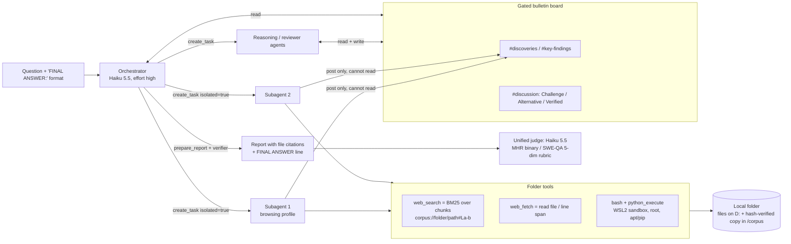

# ArcticSwarm for RAG over local folders (Claude Haiku 5.5)

This repo adapts the multi-agent deep-research framework [ArcticSwarm](https://github.com/Snowflake-AI-Research/ArcticSwarm) ([Yoon et al. 2026, arXiv:2609.01870](https://arxiv.org/abs/2609.01870)) from live-web research to **retrieval-augmented generation over a local folder of many files**:
- There is **no web search**.
- **Every agent runs on Claude Haiku 5.5.**
- Agents may run **arbitrary bash and Python over the files** inside an isolated Linux sandbox, and can install any tool or library.

The adaptation is evaluated with a [pre-registered](reports/preregistration.md) protocol on two benchmarks:
- [MultiHop-RAG](https://arxiv.org/abs/2401.15391): 609 news articles as files, multi-hop questions.
- [SWE-QA](https://arxiv.org/abs/2509.14635): repository-level code questions over real Python repos.

<!-- RESULTS:START -->
## Results (day 1, 2026-11-18; exploratory, n = 20 paired questions per condition)

All numbers below are generated by `scripts/build_paper.py` from `results/day1/metrics.json`.

| Condition | max agents | agents spawned / q | MultiHop-RAG acc. (judge) [95% CI] | EM | official overlap | evidence recall | SWE-QA score /100 [95% CI] | $/question | median latency (s) | tool calls / q | bash+python / q | errors |
|---|---|---|---|---|---|---|---|---|---|---|---|---|
| Single agent (B2) | 1 | – | 70% [40%, 89%] (n=10) | 70% | 70% | 94% | 65.9 [61.1, 71.4] (n=10) | 0.005 | 16 | 7.2 | 4.2 | 0 |
| Swarm cap 16 (M) | 16 | 6.7 | 70% [40%, 89%] (n=10) | 70% | 90% | 100% | 50.1 [43.0, 57.0] (n=10) | 0.287 | 317 | 117.0 | 45.6 | 0 |

T0 trivial baselines on all 2556 MultiHop-RAG queries (no API calls):

| Trivial answer | official word-overlap metric | normalized EM |
|---|---|---|
| majority_per_type | 55.4% | 53.1% |
| constant_hedge | 85.6% | 30.6% |

Exploratory (post hoc): answer length and SWE-QA rubric dimensions (mean, 1-20 each):

| Condition | median answer chars (MHR / SWE-QA) | correctness | completeness | relevance | clarity | reasoning | cases with no search/code tool call |
|---|---|---|---|---|---|---|---|
| Single agent (B2) | 1868 / 3200 | 12.6 | 11.3 | 13.3 | 14.8 | 13.9 | 0 |
| Swarm cap 16 (M) | 16355 / 16972 | 10.8 | 9.4 | 9.3 | 9.8 | 10.8 | 1 |

Pre-registered paired tests (M vs B2, Holm across H1/H3):

| Hypothesis | difference (M − B2) | 95% bootstrap CI | p | p (Holm) | supported |
|---|---|---|---|---|---|
| H1: MultiHop-RAG accuracy | +0% | [0%, 0%] | 1.000 | 1.000 | no |
| H3: SWE-QA score | -15.8 | [-20.5, -10.7] | 0.004 | 0.008 | no |


**In plain language:**
- **MultiHop-RAG (10 news questions):**
  - The swarm answered 70% correctly and the single agent 70%.
  - The 95% intervals are wide ([40%, 89%] vs [40%, 89%]) because n=10.
- **SWE-QA (10 code questions over real repositories):** under the strict SWE-QA rubric the swarm scored 50.1/100 and the single agent 65.9/100.
- **Cost and speed:**
  - The swarm costs $0.287 per question against $0.005 for the single agent.
  - Median time per question: 317 s against 16 s.
- **Statistics:** neither pre-registered difference is statistically supported at this sample size: Holm p = 1.000 on MultiHop-RAG and 0.008 on SWE-QA.
- **Metric sanity check:** under MultiHop-RAG's official word-overlap metric, a constant string scores 85.6%. We therefore score a forced `FINAL ANSWER:` line with a strict judge, and report exact match alongside.

<!-- RESULTS:END -->

## How it works (short)
1. **Folder corpus backend.** A new `folder` backend in ArcticSwarm walks the folder, extracts text (code, markdown, PDF, DOCX…), and splits it into line-aligned chunks. It indexes them with BM25 ([bm25s](https://github.com/xhluca/bm25s)). Agents get:
   - `web_search`: BM25 over the folder.
   - `web_fetch`: read a file or line span by path, with paging.
   - Citations of the form `corpus://folder/<path>#L<a>-<b>`.
2. **Arbitrary code execution.** `bash` and `python_execute` run as root inside a dedicated WSL2 Ubuntu distro. It has no Windows drives, no Windows interop, no API keys, and a soft no-web proxy guard that still allows package installs. The corpus is copied there and hash-verified before each run.
3. **ArcticSwarm's orchestration is unchanged.** An orchestrator posts tasks to a gated bulletin board. Isolation-mode subagents research independently, and reviewers issue Challenge/Alternative/Verified verdicts before the report is committed.

## Architecture



## What happens when you run it
1. `folderrag prepare` materialises the corpora and writes the seeded, stratified 20-question sample to `data_eval/day1_sample.jsonl` plus one CSV per folder:
   - the 609 MultiHop-RAG articles as `.md` files
   - 4 SWE-QA repositories cloned at the benchmark's pinned commits
2. `folderrag run M` (swarm) or `folderrag run B2` (single agent) does the following for each folder:
   - Copies the folder into the WSL sandbox at `/corpus/...` and verifies its hashes.
   - Runs `arcticswarm-eval` with `ArcticSwarm/conf/bench/folder_rag.yaml`. The first query builds a BM25 index, which is cached under `D:\AI\arcticswarm-folder-rag\index`.
   - Agents search, read files and run code. The terminal shows a live per-question feed of tool calls and board posts.
   - Every LLM prompt delta and response is appended to `logs/llm_calls_*.jsonl`.
   - It re-checks the sandbox copy afterwards.
3. `folderrag judge` collects every answer, then scores it with the same Haiku 5.5 judge for all conditions. It also computes token cost, latency, tool usage and gold-evidence recall.
4. `folderrag analyze` regenerates `results/<tag>/metrics.json`, `tables.md` and the figures, using the pre-registered tests.

## Repository layout
- `ArcticSwarm/`: git submodule, the adapted framework (private copy, branch `folder-rag`).
- `src/folderrag/`: evaluation harness (datasets, sandbox, runs, judge, analysis).
- `scripts/probe_haiku.py`: API request-shape probe for Haiku 5.5.
- `reports/`: literature review, state of the art, preregistration, plan, experiment reports.

## Setup (Windows 11)
```powershell
git clone --recurse-submodules https://github.com/BurnyCoder/arcticswarm-folder-rag-research.git
cd arcticswarm-folder-rag-research
uv sync
```
Put `ANTHROPIC_API_KEY` and `ANTHROPIC_WORKSPACE_ID` in `.env`. Full instructions will follow once the harness is complete.

## License
Harness code is Apache-2.0, matching ArcticSwarm. The datasets keep their own licenses: MultiHop-RAG is ODC-By and SWE-QA is Apache-2.0.
