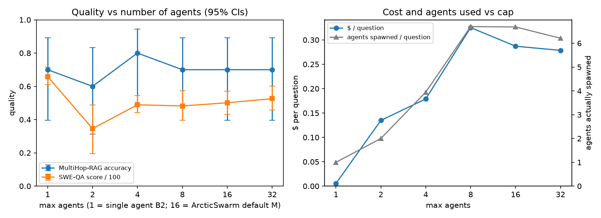

# Experiment day1-B: how many agents? Sweep over the swarm's subagent cap

- **Date:** 2026-11-18
- **Status:** completed. This is an exploratory sensitivity analysis (preregistration Amendment 2), run at the user's request after M and B2.
- **Numbers:** all filled from `results/day1/metrics.json`.

## Question and design
What number of agents is best for ArcticSwarm on local-folder RAG with Claude Haiku 5.5?

- **Knob:** `swarm.max_subagents`, the hard cap on spawned subagents. The task queue hands extra tasks to freed workers.
- **Arms:**

  | Arm | Max agents |
  |---|---|
  | `M_cap2` | 2 |
  | `M_cap4` | 4 |
  | `M_cap8` | 8 |
  | `M_cap32` | 32 (added by Amendment 3) |
  | M | 16 (ArcticSwarm default) |
  | B2 | 1 (single agent, no orchestration) |

- **Held fixed:** model, effort, tools, skills, gates, timeouts, and the same 20 question ids.
- **Concurrency:** caps 2/4/8 ran concurrently from 17:01; cap 32 started at 18:42 while caps 2/4 were finishing. Per-call API latency was unchanged by the concurrency, and the only API errors were connection resets when ArcticSwarm's watchdog closed calls at the time limit (§Checks).
- **Pre-specified reading of "optimal":** the cheapest arm whose quality CI overlaps the best arm's. This is descriptive only; there are no significance claims with n=20 per arm.

## Results

| Condition | max agents | agents spawned / q | MultiHop-RAG acc. (judge) [95% CI] | EM | official overlap | evidence recall | SWE-QA score /100 [95% CI] | $/question | median latency (s) | tool calls / q | bash+python / q | errors | hit 900 s limit |
|---|---|---|---|---|---|---|---|---|---|---|---|---|---|
| Single agent (B2) | 1 | – | 70% [40%, 89%] (n=10) | 70% | 70% | 94% | 65.9 [61.1, 71.4] (n=10) | 0.005 | 16 | 7.2 | 4.2 | 0 | 0 |
| Swarm cap 2 | 2 | 2.0 | 60% [31%, 83%] (n=10) | 60% | 80% | 100% | 34.6 [19.4, 48.8] (n=10) | 0.135 | 1205 | 15.6 | 22.3 | 5 | 17 |
| Swarm cap 4 | 4 | 3.9 | 80% [49%, 94%] (n=10) | 70% | 100% | 100% | 48.9 [44.1, 54.5] (n=10) | 0.179 | 1205 | 31.6 | 31.8 | 0 | 12 |
| Swarm cap 8 | 8 | 6.7 | 70% [40%, 89%] (n=10) | 70% | 100% | 100% | 48.2 [39.5, 57.2] (n=10) | 0.325 | 354 | 122.3 | 48.6 | 0 | 1 |
| Swarm cap 16 (M) | 16 | 6.7 | 70% [40%, 89%] (n=10) | 70% | 90% | 100% | 50.1 [43.0, 57.0] (n=10) | 0.287 | 317 | 117.0 | 45.6 | 0 | 0 |
| Swarm cap 32 | 32 | 6.2 | 70% [40%, 89%] (n=10) | 70% | 100% | 100% | 52.6 [45.8, 60.1] (n=10) | 0.279 | 282 | 110.8 | 41.9 | 0 | 0 |

T0 trivial baselines on all 2556 MultiHop-RAG queries (no API calls):

| Trivial answer | official word-overlap metric | normalized EM |
|---|---|---|
| majority_per_type | 55.4% | 53.1% |
| constant_hedge | 85.6% | 30.6% |

Exploratory (post hoc): answer length and SWE-QA rubric dimensions (mean, 1-20 each):

| Condition | median answer chars (MHR / SWE-QA) | correctness | completeness | relevance | clarity | reasoning | cases with no search/code tool call |
|---|---|---|---|---|---|---|---|
| Single agent (B2) | 1868 / 3200 | 12.6 | 11.3 | 13.3 | 14.8 | 13.9 | 0 |
| Swarm cap 2 | 17719 / 22746 | 9.7 | 8.2 | 8.0 | 8.2 | 9.0 | 1 |
| Swarm cap 4 | 18105 / 16627 | 10.0 | 8.7 | 9.5 | 9.9 | 10.8 | 1 |
| Swarm cap 8 | 15978 / 18536 | 10.1 | 8.9 | 9.7 | 9.1 | 10.4 | 0 |
| Swarm cap 16 (M) | 16355 / 16972 | 10.8 | 9.4 | 9.3 | 9.8 | 10.8 | 1 |
| Swarm cap 32 | 18225 / 21364 | 10.8 | 9.3 | 10.6 | 10.4 | 11.5 | 1 |

Pre-registered paired tests (M vs B2, Holm across H1/H3):

| Hypothesis | difference (M − B2) | 95% bootstrap CI | p | p (Holm) | supported |
|---|---|---|---|---|---|
| H1: MultiHop-RAG accuracy | +0% | [0%, 0%] | 1.000 | 1.000 | no |
| H3: SWE-QA score | -15.8 | [-20.5, -10.7] | 0.004 | 0.008 | no |

| Arm | max agents | agents actually spawned / q | MultiHop-RAG acc. [95% CI] | SWE-QA /100 [95% CI] | $/q | median s |
|---|---|---|---|---|---|---|
| B2 | 1 | 1 | 70% [40%, 89%] | 65.9 [61.1, 71.4] | $0.005 | 16 |
| M_cap2 | 2 | 2.0 | 60% [31%, 83%] | 34.6 [19.4, 48.8] | $0.135 | 1205 |
| M_cap4 | 4 | 3.9 | 80% [49%, 94%] | 48.9 [44.1, 54.5] | $0.179 | 1205 |
| M_cap8 | 8 | 6.7 | 70% [40%, 89%] | 48.2 [39.5, 57.2] | $0.325 | 354 |
| M | 16 | 6.7 | 70% [40%, 89%] | 50.1 [43.0, 57.0] | $0.287 | 317 |
| M_cap32 | 32 | 6.2 | 70% [40%, 89%] | 52.6 [45.8, 60.1] | $0.279 | 282 |

Paired differences against M (bootstrap 95% CIs; exploratory):

| Arm | MultiHop-RAG accuracy diff vs M [CI] | SWE-QA diff vs M [CI] |
|---|---|---|
| M_cap2 | -10% [-40%, 20%] | -15.5 [-33.1, 0.9] |
| M_cap4 | 10% [0%, 30%] | -1.2 [-9.0, 7.0] |
| M_cap8 | 0% [0%, 0%] | -1.9 [-8.5, 4.5] |
| M_cap32 | 0% [0%, 0%] | 2.5 [-1.5, 7.1] |

## Interpretation
- **Caps of 8 or more never bind.**
  - The orchestrator chose to spawn 6.7 (cap 8), 6.7 (cap 16) and 6.2 (cap 32) agents per question.
  - So arms 8, 16 and 32 are effectively the same system. Their quality differences are within noise: SWE-QA 48.2 / 50.1 / 52.6; cap 32 − M = 2.5, CI [-1.5, 7.1].
  - This confirms the expectation written in Amendment 3 before cap 32 ran.
- **Caps below the natural team size starve the swarm of time.** The orchestrator still plans for about 6–7 workers.
  - With 2 or 4 agents, tasks queue: 17/20 (cap 2) and 12/20 (cap 4) questions hit the 900 s budget, against 0/20 at cap 16.
  - At cap 2, 5 questions timed out completely, even after the wrap-up phase. They are scored as failures, as pre-registered.
  - Cap 2 is the worst arm: MultiHop-RAG 60%, SWE-QA 34.6.
  - Cap 4 is cheaper ($0.179/q) and on MultiHop-RAG nominally the best arm (80%, one more question right), but it ran up against the time budget on most questions.
- **Cost is not monotone in the cap.** Small caps cost less per question but take the longest wall-clock time, because the same work is serialised and then cut off.
- **"Optimal" by the pre-specified rule** (the cheapest arm whose quality CI overlaps the best arm's):
  - **MultiHop-RAG:** all arms overlap, so the cheapest arm, the **single agent (1 agent)**, is optimal.
  - **SWE-QA:** the single agent is best (65.9, CI [61.1, 71.4]), and no swarm arm's CI overlaps it.
  - So on this setup the optimal number of agents is **one**.
  - If a swarm is used, a cap at or above its natural team size (≥ 8 here) avoids time-limit failures. Raising the cap further changes nothing, because the orchestrator doesn't use the extra agents.
- **Recurring failure mode: answering without searching.** Across arms, the orchestrator sometimes answered a SWE-QA question in about 25 s from parametric memory, delegating no search. The counts are in the exploratory table's last column: M 1, cap 2 1, cap 4 1, cap 32 1. These were `sweqa_requests_00` under M and `sweqa_pytest_15` under caps 2, 4 and 32. ArcticSwarm's verifier gate did not catch it. A cheap fix would be to require at least one corpus tool call before `prepare_report` in folder mode (to-do).
- **Caveats.** n = 10 per dataset per arm and a single run. Caps 2/4/8 ran concurrently, though per-call latency was checked and unchanged. The time budget (900 s + 300 s wrap-up) interacts with the cap, so a longer budget could change the low-cap arms.

## Checks
- All arms used the same question ids and judge.
- Each arm had its own hash-verified sandbox copy of every folder (`/corpus/day1/<arm>/<folder>`).
- API errors per arm are counted from the full LLM-call logs (`logs/llm_calls_day1_<arm>_*.jsonl`).
