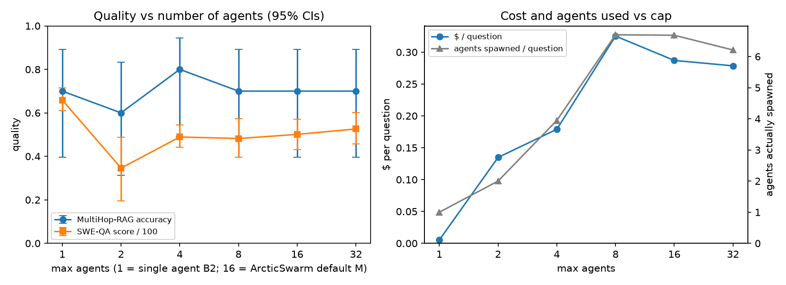

# Experiment day1-B: how many agents? Sweep over the swarm's subagent cap

- **Date:** 2026-11-18
- **Status:** completed. This is an exploratory sensitivity analysis (preregistration Amendment 2), run at the user's request after M and B2.
- **Numbers:** all filled from `results/day1/metrics.json`.

## Question and design
What number of agents is best for ArcticSwarm on local-folder RAG with Claude Haiku 5.5?

- **Knob:** `swarm.max_subagents`, the hard cap on spawned subagents. The task queue hands extra tasks to freed workers.
- **Arms:**

  | Arm | Max agents |
  |---|---|
  | `M_cap2` | 2 |
  | `M_cap4` | 4 |
  | `M_cap8` | 8 |
  | `M_cap32` | 32 (added by Amendment 3) |
  | M | 16 (ArcticSwarm default) |
  | B2 | 1 (single agent, no orchestration) |

- **Held fixed:** model, effort, tools, skills, gates, timeouts, and the same 20 question ids.
- **Concurrency:** caps 2/4/8 ran concurrently from 17:01; cap 32 started at 18:42 while caps 2/4 were finishing. Per-call API latency was unchanged by the concurrency, and the only API errors were connection resets when ArcticSwarm's watchdog closed calls at the time limit (§Checks).
- **Pre-specified reading of "optimal":** the cheapest arm whose quality CI overlaps the best arm's. This is descriptive only; there are no significance claims with n=20 per arm.

## Results

{{TABLES}}

| Arm | max agents | agents actually spawned / q | MultiHop-RAG acc. [95% CI] | SWE-QA /100 [95% CI] | $/q | median s |
|---|---|---|---|---|---|---|
| B2 | 1 | 1 | {{summary.B2.mhr_judge_acc|pct}} {{summary.B2.mhr_judge_ci|pctci}} | {{summary.B2.swe_mean|f1}} {{summary.B2.swe_ci|f1ci}} | {{summary.B2.cost_usd_per_q|usd}} | {{summary.B2.latency_s_median|int}} |
| M_cap2 | 2 | {{summary.M_cap2.agents_spawned_mean|f1}} | {{summary.M_cap2.mhr_judge_acc|pct}} {{summary.M_cap2.mhr_judge_ci|pctci}} | {{summary.M_cap2.swe_mean|f1}} {{summary.M_cap2.swe_ci|f1ci}} | {{summary.M_cap2.cost_usd_per_q|usd}} | {{summary.M_cap2.latency_s_median|int}} |
| M_cap4 | 4 | {{summary.M_cap4.agents_spawned_mean|f1}} | {{summary.M_cap4.mhr_judge_acc|pct}} {{summary.M_cap4.mhr_judge_ci|pctci}} | {{summary.M_cap4.swe_mean|f1}} {{summary.M_cap4.swe_ci|f1ci}} | {{summary.M_cap4.cost_usd_per_q|usd}} | {{summary.M_cap4.latency_s_median|int}} |
| M_cap8 | 8 | {{summary.M_cap8.agents_spawned_mean|f1}} | {{summary.M_cap8.mhr_judge_acc|pct}} {{summary.M_cap8.mhr_judge_ci|pctci}} | {{summary.M_cap8.swe_mean|f1}} {{summary.M_cap8.swe_ci|f1ci}} | {{summary.M_cap8.cost_usd_per_q|usd}} | {{summary.M_cap8.latency_s_median|int}} |
| M | 16 | {{summary.M.agents_spawned_mean|f1}} | {{summary.M.mhr_judge_acc|pct}} {{summary.M.mhr_judge_ci|pctci}} | {{summary.M.swe_mean|f1}} {{summary.M.swe_ci|f1ci}} | {{summary.M.cost_usd_per_q|usd}} | {{summary.M.latency_s_median|int}} |
| M_cap32 | 32 | {{summary.M_cap32.agents_spawned_mean|f1}} | {{summary.M_cap32.mhr_judge_acc|pct}} {{summary.M_cap32.mhr_judge_ci|pctci}} | {{summary.M_cap32.swe_mean|f1}} {{summary.M_cap32.swe_ci|f1ci}} | {{summary.M_cap32.cost_usd_per_q|usd}} | {{summary.M_cap32.latency_s_median|int}} |

Paired differences against M (bootstrap 95% CIs; exploratory):

| Arm | MultiHop-RAG accuracy diff vs M [CI] | SWE-QA diff vs M [CI] |
|---|---|---|
| M_cap2 | {{sweep_vs_M.M_cap2.H1.diff|pct}} {{sweep_vs_M.M_cap2.H1.ci|pctci}} | {{sweep_vs_M.M_cap2.H3.diff|f1}} {{sweep_vs_M.M_cap2.H3.ci|f1ci}} |
| M_cap4 | {{sweep_vs_M.M_cap4.H1.diff|pct}} {{sweep_vs_M.M_cap4.H1.ci|pctci}} | {{sweep_vs_M.M_cap4.H3.diff|f1}} {{sweep_vs_M.M_cap4.H3.ci|f1ci}} |
| M_cap8 | {{sweep_vs_M.M_cap8.H1.diff|pct}} {{sweep_vs_M.M_cap8.H1.ci|pctci}} | {{sweep_vs_M.M_cap8.H3.diff|f1}} {{sweep_vs_M.M_cap8.H3.ci|f1ci}} |
| M_cap32 | {{sweep_vs_M.M_cap32.H1.diff|pct}} {{sweep_vs_M.M_cap32.H1.ci|pctci}} | {{sweep_vs_M.M_cap32.H3.diff|f1}} {{sweep_vs_M.M_cap32.H3.ci|f1ci}} |

## Interpretation
- **Caps of 8 or more never bind.**
  - The orchestrator chose to spawn {{summary.M_cap8.agents_spawned_mean|f1}} (cap 8), {{summary.M.agents_spawned_mean|f1}} (cap 16) and {{summary.M_cap32.agents_spawned_mean|f1}} (cap 32) agents per question.
  - So arms 8, 16 and 32 are effectively the same system. Their quality differences are within noise: SWE-QA {{summary.M_cap8.swe_mean|f1}} / {{summary.M.swe_mean|f1}} / {{summary.M_cap32.swe_mean|f1}}; cap 32 − M = {{sweep_vs_M.M_cap32.H3.diff|f1}}, CI {{sweep_vs_M.M_cap32.H3.ci|f1ci}}.
  - This confirms the expectation written in Amendment 3 before cap 32 ran.
- **Caps below the natural team size starve the swarm of time.** The orchestrator still plans for about 6–7 workers.
  - With 2 or 4 agents, tasks queue: {{summary.M_cap2.hit_time_limit|int}}/20 (cap 2) and {{summary.M_cap4.hit_time_limit|int}}/20 (cap 4) questions hit the 900 s budget, against {{summary.M.hit_time_limit|int}}/20 at cap 16.
  - At cap 2, {{summary.M_cap2.errors|int}} questions timed out completely, even after the wrap-up phase. They are scored as failures, as pre-registered.
  - Cap 2 is the worst arm: MultiHop-RAG {{summary.M_cap2.mhr_judge_acc|pct}}, SWE-QA {{summary.M_cap2.swe_mean|f1}}.
  - Cap 4 is cheaper ({{summary.M_cap4.cost_usd_per_q|usd}}/q) and on MultiHop-RAG nominally the best arm ({{summary.M_cap4.mhr_judge_acc|pct}}, one more question right), but it ran up against the time budget on most questions.
- **Cost is not monotone in the cap.** Small caps cost less per question but take the longest wall-clock time, because the same work is serialised and then cut off.
- **"Optimal" by the pre-specified rule** (the cheapest arm whose quality CI overlaps the best arm's):
  - **MultiHop-RAG:** all arms overlap, so the cheapest arm, the **single agent (1 agent)**, is optimal.
  - **SWE-QA:** the single agent is best ({{summary.B2.swe_mean|f1}}, CI {{summary.B2.swe_ci|f1ci}}), and no swarm arm's CI overlaps it.
  - So on this setup the optimal number of agents is **one**.
  - If a swarm is used, a cap at or above its natural team size (≥ 8 here) avoids time-limit failures. Raising the cap further changes nothing, because the orchestrator doesn't use the extra agents.
- **Recurring failure mode: answering without searching.** Across arms, the orchestrator sometimes answered a SWE-QA question in about 25 s from parametric memory, delegating no search. The counts are in the exploratory table's last column: M {{summary.M.no_tool_call_cases|int}}, cap 2 {{summary.M_cap2.no_tool_call_cases|int}}, cap 4 {{summary.M_cap4.no_tool_call_cases|int}}, cap 32 {{summary.M_cap32.no_tool_call_cases|int}}. These were `sweqa_requests_00` under M and `sweqa_pytest_15` under caps 2, 4 and 32. ArcticSwarm's verifier gate did not catch it. A cheap fix would be to require at least one corpus tool call before `prepare_report` in folder mode (to-do).
- **Caveats.** n = 10 per dataset per arm and a single run. Caps 2/4/8 ran concurrently, though per-call latency was checked and unchanged. The time budget (900 s + 300 s wrap-up) interacts with the cap, so a longer budget could change the low-cap arms.

## Checks
- All arms used the same question ids and judge.
- Each arm had its own hash-verified sandbox copy of every folder (`/corpus/day1/<arm>/<folder>`).
- API errors per arm are counted from the full LLM-call logs (`logs/llm_calls_day1_<arm>_*.jsonl`).
