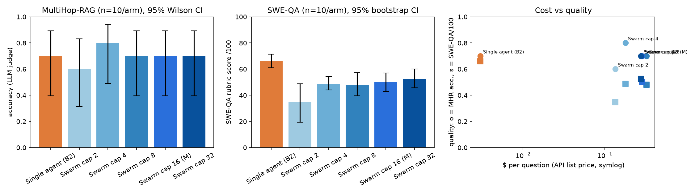
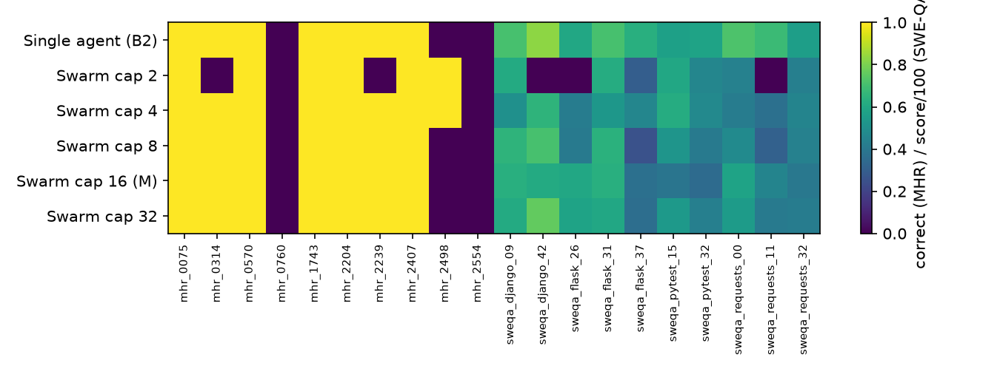

# Experiment day1-A: ArcticSwarm swarm (M) vs ArcticSwarm single agent (B2) on local folders

- **Date:** 2026-11-18
- **Author:** Libor "Burny" Burian, implementation by Claude Code
- **Status:** completed. Pre-registered, with Amendment 1 setting n = 20 per condition. Single run, single seed (the API exposes none).
- **Numbers:** every number below is filled from `results/day1/metrics.json` by `scripts/build_paper.py`.

## Question
On local-folder RAG with Claude Haiku 5.5, does ArcticSwarm's gated-bulletin-board swarm beat its own single-agent harness when the model, tools and prompts are the same?

## Setup
- **Model:** `claude-haiku-5-5` for every role.
  - Effort is `high` for the orchestrator and single agent, and `medium` for subagents and auditor.
  - Adaptive thinking; compaction at 90K tokens.
- **Tools (both conditions):**
  - `web_search`: BM25 over line-aligned chunks of the folder.
  - `web_fetch`: read a file or line span by path.
  - `bash` and `python_execute`: run in an isolated WSL2 sandbox as root, with apt/pip available.
- **M:** `ArcticSwarm/conf/bench/folder_rag.yaml`. Paper defaults for the gates, with `max_subagents` 16.
- **B2:** the same config plus `folder_rag_single_agent.yaml` (`swarm.enabled=false`).
- **Data:** 20 questions. The same ids were used in both conditions.
  - 10 MultiHop-RAG questions: 3 inference, 4 comparison, 2 temporal, 1 null.
  - 10 SWE-QA questions: requests 3, flask 3, pytest 2, django 2.
- **Judging:** one Haiku 5.5 judge for both conditions.
  - MultiHop-RAG: strict binary verdict on the `FINAL ANSWER:` line.
  - SWE-QA: the paper's 5-dimension rubric, copied verbatim.
- **Pre-registered tests:**
  - H1: exact McNemar.
  - H3: Wilcoxon signed-rank.
  - Holm correction over both.

## Results

| Condition | max agents | agents spawned / q | MultiHop-RAG acc. (judge) [95% CI] | EM | official overlap | evidence recall | SWE-QA score /100 [95% CI] | $/question | median latency (s) | tool calls / q | bash+python / q | errors | hit 900 s limit |
|---|---|---|---|---|---|---|---|---|---|---|---|---|---|
| Single agent (B2) | 1 | – | 70% [40%, 89%] (n=10) | 70% | 70% | 94% | 65.9 [61.1, 71.4] (n=10) | 0.005 | 16 | 7.2 | 4.2 | 0 | 0 |
| Swarm cap 2 | 2 | 2.0 | 60% [31%, 83%] (n=10) | 60% | 80% | 100% | 34.6 [19.4, 48.8] (n=10) | 0.135 | 1205 | 15.6 | 22.3 | 5 | 17 |
| Swarm cap 4 | 4 | 3.9 | 80% [49%, 94%] (n=10) | 70% | 100% | 100% | 48.9 [44.1, 54.5] (n=10) | 0.179 | 1205 | 31.6 | 31.8 | 0 | 12 |
| Swarm cap 8 | 8 | 6.7 | 70% [40%, 89%] (n=10) | 70% | 100% | 100% | 48.2 [39.5, 57.2] (n=10) | 0.325 | 354 | 122.3 | 48.6 | 0 | 1 |
| Swarm cap 16 (M) | 16 | 6.7 | 70% [40%, 89%] (n=10) | 70% | 90% | 100% | 50.1 [43.0, 57.0] (n=10) | 0.287 | 317 | 117.0 | 45.6 | 0 | 0 |
| Swarm cap 32 | 32 | 6.2 | 70% [40%, 89%] (n=10) | 70% | 100% | 100% | 52.6 [45.8, 60.1] (n=10) | 0.279 | 282 | 110.8 | 41.9 | 0 | 0 |

T0 trivial baselines on all 2556 MultiHop-RAG queries (no API calls):

| Trivial answer | official word-overlap metric | normalized EM |
|---|---|---|
| majority_per_type | 55.4% | 53.1% |
| constant_hedge | 85.6% | 30.6% |

Exploratory (post hoc): answer length and SWE-QA rubric dimensions (mean, 1-20 each):

| Condition | median answer chars (MHR / SWE-QA) | correctness | completeness | relevance | clarity | reasoning | cases with no search/code tool call |
|---|---|---|---|---|---|---|---|
| Single agent (B2) | 1868 / 3200 | 12.6 | 11.3 | 13.3 | 14.8 | 13.9 | 0 |
| Swarm cap 2 | 17719 / 22746 | 9.7 | 8.2 | 8.0 | 8.2 | 9.0 | 1 |
| Swarm cap 4 | 18105 / 16627 | 10.0 | 8.7 | 9.5 | 9.9 | 10.8 | 1 |
| Swarm cap 8 | 15978 / 18536 | 10.1 | 8.9 | 9.7 | 9.1 | 10.4 | 0 |
| Swarm cap 16 (M) | 16355 / 16972 | 10.8 | 9.4 | 9.3 | 9.8 | 10.8 | 1 |
| Swarm cap 32 | 18225 / 21364 | 10.8 | 9.3 | 10.6 | 10.4 | 11.5 | 1 |

Pre-registered paired tests (M vs B2, Holm across H1/H3):

| Hypothesis | difference (M − B2) | 95% bootstrap CI | p | p (Holm) | supported |
|---|---|---|---|---|---|
| H1: MultiHop-RAG accuracy | +0% | [0%, 0%] | 1.000 | 1.000 | no |
| H3: SWE-QA score | -15.8 | [-20.5, -10.7] | 0.004 | 0.008 | no |

**MultiHop-RAG (H1).**
- Both conditions answered 70% correctly (95% Wilson CI [40%, 89%]).
- The per-question outcomes were identical: both failed the same three questions.
- McNemar p = 1.000. **H1 is not supported.**
- Gold-evidence files appeared in 100% of the swarm's trajectories and 94% of the single agent's.
- The failures were therefore reasoning or verdict errors on evidence that had been retrieved, not retrieval failures. Two of the three shared failures are a yes/no comparison answered "Insufficient information" or "No", and one is a hedge ("Yes; No").

**SWE-QA (H3).**
- The swarm scored 50.1/100 and the single agent 65.9/100.
- The difference is -15.8 points (95% paired-bootstrap CI [-20.5, -10.7]), Wilcoxon p = 0.004, Holm-adjusted p = 0.008.
- This is a **statistically significant difference in the opposite direction from H3**, i.e. a negative result for the swarm on this setup.

**Cost and latency.** Using the API list price over all agent calls:

| | Swarm (M) | Single agent (B2) |
|---|---|---|
| Cost per question | $0.287 | $0.005 |
| Median latency | 317 s | 16 s |
| Tool calls per question | 117.0 | 7.2 |

The swarm spawned 6.7 agents per question on average.

## Exploratory (post hoc, not pre-registered)
- **Answer length.** The swarm's final reports were much longer: median 16972 characters on SWE-QA, against 3200 for the single agent.
  - Over the 20 SWE-QA answers, length correlated negatively with rubric score: Spearman ρ = -0.39, p = 0.002.
  - This correlation is confounded with condition, because length mostly separates M from B2.
- **Rubric dimensions** (swarm vs single agent):

  | Dimension | Swarm (M) | Single agent (B2) |
  |---|---|---|
  | Correctness | 10.8 | 12.6 |
  | Relevance | 9.3 | 13.3 |
  | Clarity | 9.8 | 14.8 |

  The gap is largest on clarity and relevance and smallest on correctness.
- **Hypothesis for a future, pre-registered test.** Much of the swarm's SWE-QA deficit comes from report format and verbosity: the strict rubric penalises off-topic or extra content. Content accuracy accounts for less of it. Test: constrain the swarm's final answer length, or judge only an answer section.
- **No-tool case.** In 1 swarm case (`sweqa_requests_00`) the orchestrator answered *from memory*, without delegating any search; its answer says so. The verifier gate let it through. ArcticSwarm's runner flagged it ("NO browsing tool calls"). The case is kept, as pre-registered.

## Interpretation
- **No measurable benefit here.** On these small folders and with Haiku 5.5, the swarm gave no accuracy benefit on multi-hop news QA. It scored worse on code QA under the SWE-QA rubric, at 54.2× the cost and 19.8× the median latency.
- **Why this regime differs from the paper's.** ArcticSwarm's published gains are on BrowseComp-style questions, whose obscure answers reward diverse, long search. In our folders a single agent with grep/BM25 already retrieved the gold evidence in nearly every case, so there was little room for deferred consensus to add recall.
- **What the swarm did do.** Reviewers raised Challenges, for example on `mhr_0314`. On the shared failures, the evidence was in hand but the final verdicts were not improved.
- **Limits of these claims.** With n = 10 per dataset these are *existence-proof / narrow* claims for this configuration, not systematic ones.

## Learnings (issues hit and how they were resolved)

| # | Issue | Cause | Fix / decision | How it was found |
|---|---|---|---|---|
| 1 | `arcticswarm-eval` crashed at import on Windows | `csv.field_size_limit(sys.maxsize)` overflows; POSIX `fcntl`/`termios` imports | Clamp to 2**31-1; guarded imports with a no-op lock / msvcrt | Explore pass + test run |
| 2 | Every Haiku 5.5 call would 400 | ArcticSwarm sent `budget_tokens` thinking | Adaptive thinking + `output_config.effort` for Claude 4.6+ models | `scripts/probe_haiku.py` |
| 3 | 400: "key not scoped to a workspace" | Workspace-less API key | `anthropic-workspace-id` header from `ANTHROPIC_WORKSPACE_ID` in one shared client builder | Probe |
| 4 | Fallback ladder never ran | `fallback.py` used an undefined `logger` (NameError swallowed) | Defined the logger | Code reading |
| 5 | Anthropic key could be sent to OpenAI | Scorer/compactor fallback used `openai_api_key or api_key` | Fallback disabled without OpenAI credentials; never reuse the key | Code reading |
| 6 | "Local corpus" mode unusable for folders | Template token-overlap scorer, no doc ids, fetch = re-search | New BM25 folder backend with citable `path#La-b` ids and fetch by path | Code reading |
| 7 | Reflection JSON truncated ("Unterminated string") | Haiku 5.5 thinks by default; reflection used max_tokens=1024 | 8K budget at low effort for default-thinking Claude models | Smoke-test log |
| 8 | Unpinned install pulled anthropic 2.x / openai 3.x / mcp 2.x | Loose lower bounds in ArcticSwarm's pyproject | Pinned to ArcticSwarm's `requirements.txt` versions | `uv sync` output |
| 9 | Official MultiHop-RAG metric is gameable (constant string: 85.6%) | Any shared word counts as correct | `FINAL ANSWER:` line + strict judge + normalized EM | Literature review, replicated |
| 10 | Blobless repo clones carry future commits in `.git` | `git clone --filter=blob:none` | `.git` never copied into the sandbox or indexed | Design review |
| 11 | Agents created `__pycache__` in the sandbox corpus (requests, django) | Importing the package under study | Benign (no source changed); every run re-syncs and hash-verifies a fresh copy | Post-run integrity check |
| 12 | Normalized EM's yes/no rule accepts the hedge "Yes; No" | Prefix rule as pre-registered | Kept as registered; the primary judge marks hedges wrong | Reading judged outputs |
