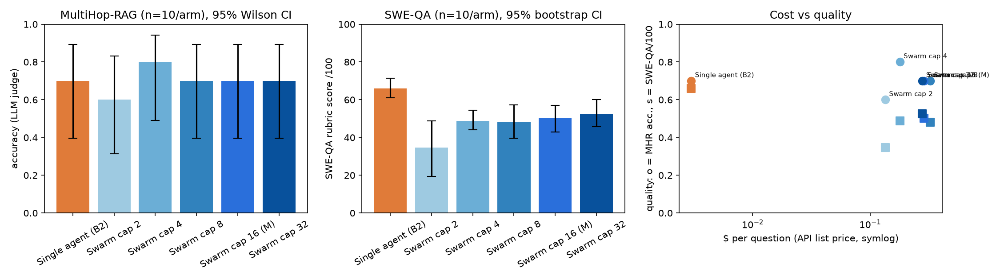
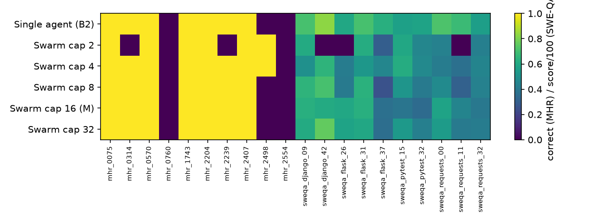

# Experiment day1-A: ArcticSwarm swarm (M) vs ArcticSwarm single agent (B2) on local folders

- **Date:** 2026-11-18
- **Author:** Libor "Burny" Burian, implementation by Claude Code
- **Status:** completed. Pre-registered, with Amendment 1 setting n = 20 per condition. Single run, single seed (the API exposes none).
- **Numbers:** every number below is filled from `results/day1/metrics.json` by `scripts/build_paper.py`.

## Question
On local-folder RAG with Claude Haiku 5.5, does ArcticSwarm's gated-bulletin-board swarm beat its own single-agent harness when the model, tools and prompts are the same?

## Setup
- **Model:** `claude-haiku-5-5` for every role.
  - Effort is `high` for the orchestrator and single agent, and `medium` for subagents and auditor.
  - Adaptive thinking; compaction at 90K tokens.
- **Tools (both conditions):**
  - `web_search`: BM25 over line-aligned chunks of the folder.
  - `web_fetch`: read a file or line span by path.
  - `bash` and `python_execute`: run in an isolated WSL2 sandbox as root, with apt/pip available.
- **M:** `ArcticSwarm/conf/bench/folder_rag.yaml`. Paper defaults for the gates, with `max_subagents` 16.
- **B2:** the same config plus `folder_rag_single_agent.yaml` (`swarm.enabled=false`).
- **Data:** 20 questions. The same ids were used in both conditions.
  - 10 MultiHop-RAG questions: 3 inference, 4 comparison, 2 temporal, 1 null.
  - 10 SWE-QA questions: requests 3, flask 3, pytest 2, django 2.
- **Judging:** one Haiku 5.5 judge for both conditions.
  - MultiHop-RAG: strict binary verdict on the `FINAL ANSWER:` line.
  - SWE-QA: the paper's 5-dimension rubric, copied verbatim.
- **Pre-registered tests:**
  - H1: exact McNemar.
  - H3: Wilcoxon signed-rank.
  - Holm correction over both.

## Results

{{TABLES}}

**MultiHop-RAG (H1).**
- Both conditions answered {{summary.M.mhr_judge_acc|pct}} correctly (95% Wilson CI {{summary.M.mhr_judge_ci|pctci}}).
- The per-question outcomes were identical: both failed the same three questions.
- McNemar p = {{tests.H1.p|f3}}. **H1 is not supported.**
- Gold-evidence files appeared in {{summary.M.mhr_evidence_recall|pct}} of the swarm's trajectories and {{summary.B2.mhr_evidence_recall|pct}} of the single agent's.
- The failures were therefore reasoning or verdict errors on evidence that had been retrieved, not retrieval failures. Two of the three shared failures are a yes/no comparison answered "Insufficient information" or "No", and one is a hedge ("Yes; No").

**SWE-QA (H3).**
- The swarm scored {{summary.M.swe_mean|f1}}/100 and the single agent {{summary.B2.swe_mean|f1}}/100.
- The difference is {{tests.H3.diff|f1}} points (95% paired-bootstrap CI {{tests.H3.ci|f1ci}}), Wilcoxon p = {{tests.H3.p|f3}}, Holm-adjusted p = {{tests.H3.p_holm|f3}}.
- This is a **statistically significant difference in the opposite direction from H3**, i.e. a negative result for the swarm on this setup.

**Cost and latency.** Using the API list price over all agent calls:

| | Swarm (M) | Single agent (B2) |
|---|---|---|
| Cost per question | {{summary.M.cost_usd_per_q|usd}} | {{summary.B2.cost_usd_per_q|usd}} |
| Median latency | {{summary.M.latency_s_median|int}} s | {{summary.B2.latency_s_median|int}} s |
| Tool calls per question | {{summary.M.tool_calls_mean|f1}} | {{summary.B2.tool_calls_mean|f1}} |

The swarm spawned {{summary.M.agents_spawned_mean|f1}} agents per question on average.

## Exploratory (post hoc, not pre-registered)
- **Answer length.** The swarm's final reports were much longer: median {{summary.M.resp_chars_median_swe|int}} characters on SWE-QA, against {{summary.B2.resp_chars_median_swe|int}} for the single agent.
  - Over the 20 SWE-QA answers, length correlated negatively with rubric score: Spearman ρ = {{exploratory_length_vs_score.spearman_rho|f2}}, p = {{exploratory_length_vs_score.p|f3}}.
  - This correlation is confounded with condition, because length mostly separates M from B2.
- **Rubric dimensions** (swarm vs single agent):

  | Dimension | Swarm (M) | Single agent (B2) |
  |---|---|---|
  | Correctness | {{summary.M.swe_dims.correctness|f1}} | {{summary.B2.swe_dims.correctness|f1}} |
  | Relevance | {{summary.M.swe_dims.relevance|f1}} | {{summary.B2.swe_dims.relevance|f1}} |
  | Clarity | {{summary.M.swe_dims.clarity|f1}} | {{summary.B2.swe_dims.clarity|f1}} |

  The gap is largest on clarity and relevance and smallest on correctness.
- **Hypothesis for a future, pre-registered test.** Much of the swarm's SWE-QA deficit comes from report format and verbosity: the strict rubric penalises off-topic or extra content. Content accuracy accounts for less of it. Test: constrain the swarm's final answer length, or judge only an answer section.
- **No-tool case.** In {{summary.M.no_tool_call_cases|int}} swarm case (`sweqa_requests_00`) the orchestrator answered *from memory*, without delegating any search; its answer says so. The verifier gate let it through. ArcticSwarm's runner flagged it ("NO browsing tool calls"). The case is kept, as pre-registered.

## Interpretation
- **No measurable benefit here.** On these small folders and with Haiku 5.5, the swarm gave no accuracy benefit on multi-hop news QA. It scored worse on code QA under the SWE-QA rubric, at {{ratios.cost_M_over_B2|f1}}× the cost and {{ratios.latency_M_over_B2|f1}}× the median latency.
- **Why this regime differs from the paper's.** ArcticSwarm's published gains are on BrowseComp-style questions, whose obscure answers reward diverse, long search. In our folders a single agent with grep/BM25 already retrieved the gold evidence in nearly every case, so there was little room for deferred consensus to add recall.
- **What the swarm did do.** Reviewers raised Challenges, for example on `mhr_0314`. On the shared failures, the evidence was in hand but the final verdicts were not improved.
- **Limits of these claims.** With n = 10 per dataset these are *existence-proof / narrow* claims for this configuration, not systematic ones.

## Learnings (issues hit and how they were resolved)

| # | Issue | Cause | Fix / decision | How it was found |
|---|---|---|---|---|
| 1 | `arcticswarm-eval` crashed at import on Windows | `csv.field_size_limit(sys.maxsize)` overflows; POSIX `fcntl`/`termios` imports | Clamp to 2**31-1; guarded imports with a no-op lock / msvcrt | Explore pass + test run |
| 2 | Every Haiku 5.5 call would 400 | ArcticSwarm sent `budget_tokens` thinking | Adaptive thinking + `output_config.effort` for Claude 4.6+ models | `scripts/probe_haiku.py` |
| 3 | 400: "key not scoped to a workspace" | Workspace-less API key | `anthropic-workspace-id` header from `ANTHROPIC_WORKSPACE_ID` in one shared client builder | Probe |
| 4 | Fallback ladder never ran | `fallback.py` used an undefined `logger` (NameError swallowed) | Defined the logger | Code reading |
| 5 | Anthropic key could be sent to OpenAI | Scorer/compactor fallback used `openai_api_key or api_key` | Fallback disabled without OpenAI credentials; never reuse the key | Code reading |
| 6 | "Local corpus" mode unusable for folders | Template token-overlap scorer, no doc ids, fetch = re-search | New BM25 folder backend with citable `path#La-b` ids and fetch by path | Code reading |
| 7 | Reflection JSON truncated ("Unterminated string") | Haiku 5.5 thinks by default; reflection used max_tokens=1024 | 8K budget at low effort for default-thinking Claude models | Smoke-test log |
| 8 | Unpinned install pulled anthropic 2.x / openai 3.x / mcp 2.x | Loose lower bounds in ArcticSwarm's pyproject | Pinned to ArcticSwarm's `requirements.txt` versions | `uv sync` output |
| 9 | Official MultiHop-RAG metric is gameable (constant string: {{trivial_baselines.constant_hedge.official_overlap|pct1}}) | Any shared word counts as correct | `FINAL ANSWER:` line + strict judge + normalized EM | Literature review, replicated |
| 10 | Blobless repo clones carry future commits in `.git` | `git clone --filter=blob:none` | `.git` never copied into the sandbox or indexed | Design review |
| 11 | Agents created `__pycache__` in the sandbox corpus (requests, django) | Importing the package under study | Benign (no source changed); every run re-syncs and hash-verifies a fresh copy | Post-run integrity check |
| 12 | Normalized EM's yes/no rule accepts the hedge "Yes; No" | Prefix rule as pre-registered | Kept as registered; the primary judge marks hedges wrong | Reading judged outputs |
