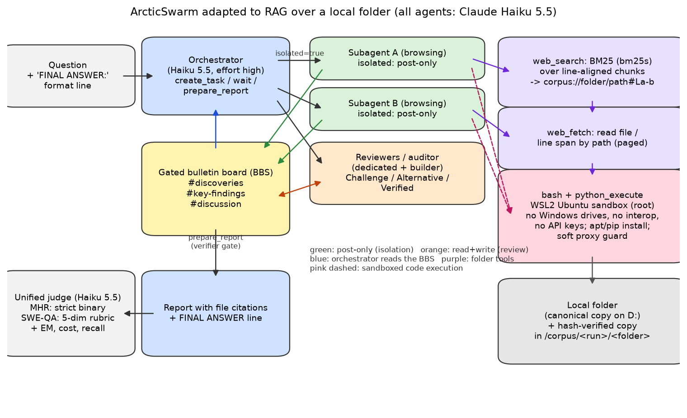
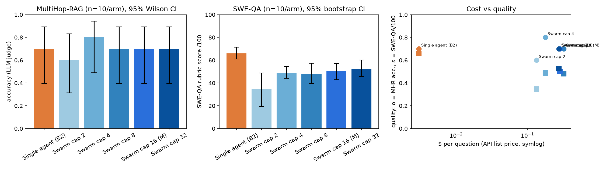
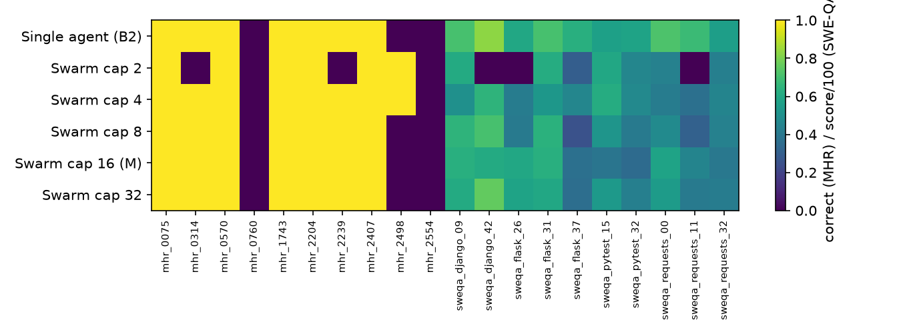

# Abstract

ArcticSwarm ([Yoon et al. 2026](https://arxiv.org/abs/2609.01870)) is a multi-agent deep-research framework. It defers early consensus: subagents research in isolation and post to a gated bulletin board, and reviewers must challenge or verify candidates before a report is committed. Its published gains come from live-web and fixed-corpus browsing (BrowseComp, BrowseComp-Plus).

We adapt it to retrieval-augmented generation (RAG) over **a local folder of many files**, with no web access. The adaptation adds:
- a BM25 folder-corpus backend with citable `path#Lstart-end` ids
- file reads by path
- **arbitrary bash/Python execution** in an isolated WSL2 sandbox where agents can install any tool

All roles run on `claude-haiku-5-5`.

On a pre-registered, paired 20-question sample (10 MultiHop-RAG multi-hop news questions over 609 article files; 10 SWE-QA repository questions over requests, flask, pytest and django at pinned commits), the full swarm (M) reached:
- **MultiHop-RAG:** 70% judge accuracy (95% CI [40%, 89%]), against 70% ([40%, 89%]) for the single-agent ArcticSwarm harness (B2) with identical tools.
- **SWE-QA:** a rubric score of 50.1/100, against 65.9/100.
- **Cost:** $0.287 per question, against $0.005.

The pre-registered paired tests:
- MultiHop-RAG, M − B2 = 0%: Holm-adjusted p = 1.000
- SWE-QA, M − B2 = -15.8: Holm-adjusted p = 0.008

With n=10 per dataset these tests are underpowered, and the day-1 results are exploratory. We release the fork, harness, preregistration and all judged outputs.

# 1. Introduction and motivation

"Chat with your folder" is a common RAG use case: answering questions from a directory of documents or a code repository. Two design families compete:
- **Vector or keyword retrieval:** top-k chunks are stuffed into a prompt.
- **Agentic search:** an LLM iteratively runs search tools, reads files and executes code (see [state-of-the-art-review.md](../state-of-the-art-review.md)).

Multi-agent systems add parallel, diverse search. ArcticSwarm's thesis is that diversity must be protected from *premature consensus* (Yoon et al. 2026). Its evidence comes from web-scale questions with obscure answers and frontier models. We ask whether the same orchestration helps in a different regime:
- small, closed folders
- a small, cheap model (Haiku 5.5)
- agents that can run arbitrary code over the files

**Novelty.** To our knowledge this is the first adaptation of ArcticSwarm's gated-BBS orchestration to local-folder RAG with sandboxed arbitrary code execution, evaluated against its own single-agent harness under a preregistration. Contributions:
1. A folder-corpus backend and a WSL2 sandbox execution backend for ArcticSwarm.
2. A reproducible, pre-registered evaluation harness.
3. A day-1 paired comparison of swarm vs single agent.
4. An agent-count sweep (Amendment 2).

# 2. Background and related work

The full annotated review, with sources, is in [literature-review.md](../literature-review.md).

- **ArcticSwarm** (Yoon et al. 2026):
  - BBS isolation for exploration tasks, reviewer verdicts (Challenge/Alternative/Verified), and verifier-gated reporting.
  - On BrowseComp-Plus with Qwen 3.5-27B it reports a single agent at 48.4%, direct messaging at 61.9%, a duo at 66.1% and the gated BBS at 82.6%.
- **MultiHop-RAG** ([Tang & Yang 2024](https://arxiv.org/abs/2401.15391)): 609 news articles and 2,556 queries; GPT-4 scores 0.56 with retrieved chunks and 0.89 with gold evidence. We found its official word-overlap metric to be gameable (§4.1).
- **SWE-QA** ([Peng et al. 2026](https://arxiv.org/abs/2509.14635)): repository-level code QA with a 5-dimension LLM-judge rubric.
- **Retrieval:** BM25 via bm25s ([Lù 2024](https://arxiv.org/abs/2407.03618)).
- **Code-acting agents:** CodeAct, SWE-agent and OpenHands motivate giving agents a shell and Python.
- **LLM-as-a-judge bias:** self-preference, [Panickssery et al. 2024](https://arxiv.org/abs/2404.13076).

# 3. Method

## 3.1 System

The fork lives in the `ArcticSwarm/` submodule, branch `folder-rag`.

- **Folder corpus (`web.corpus_backend: folder`):**
  - Recursive file walk, skipping `.git`, caches and binary files.
  - Text extraction: UTF-8; PDF via pypdf; DOCX/PPTX/HTML via markitdown.
  - Line-aligned chunks of about 1,500 characters with 2 lines of overlap.
  - Identifier splitting: snake_case, camelCase and paths are split, for documents and queries alike.
  - BM25 via bm25s, with English stopwords and the Snowball stemmer.
- **Search and fetch:**
  - `web_search` returns `path (lines a-b)` and a `corpus://folder/<path>#La-b` id.
  - `web_fetch` reads a file or line span by id, paged at the tool-output cap.
  - The tool names are kept because ArcticSwarm's review gates are keyed on them.
- **Code execution (`tools.exec_backend: wsl`):**
  - `bash` and `python_execute` run as root in a dedicated WSL2 Ubuntu 24.04 distro.
  - Isolation: Windows drive automount and interop are disabled, and no Windows environment (no API keys) is forwarded.
  - Agents may `apt-get` or `pip install` anything; a `packages=` argument covers Python libraries.
  - A soft proxy guard allows only package hosts.
  - Before every run the corpus is copied into the sandbox and SHA-256 verified.
- **Model:** `claude-haiku-5-5` for every role.
  - Adaptive thinking; effort `high` for the orchestrator and `medium` for subagents and the auditor.
  - Context compaction at 90K tokens, to stay on the ≤100K-token price card.
  - The source scorer is disabled.
  - An API probe showed that Haiku 5.5 rejects ArcticSwarm's `budget_tokens` thinking, so the client was patched.
- **Prompts and skills:** folder-specific identity and skills. The web-specific heuristics (region and language pivots, anti-fame bias, "always one answer") were removed, because a folder may not contain the answer.

## 3.2 Conditions
- **M:** the full gated-BBS swarm (`conf/bench/folder_rag.yaml`).
- **B2:** ArcticSwarm single agent (`swarm.enabled=false`) with identical tools, skills, model and effort.
- **Agent-count sweep:** `swarm.max_subagents` ∈ {2, 4, 8}, against the default of 16 in M.

## 3.3 Data and sampling
- 10 MultiHop-RAG questions, stratified by question type: inference 3, comparison 4, temporal 2, null 1.
- 10 SWE-QA v2 questions: requests 3, flask 3, pytest 2, django 2.
- Seeded stratified ordering with seed 20261118.
- The MultiHop-RAG articles are written as `<source>/<date>_<title>.md` files with a metadata header. The SWE-QA repositories are cloned at the benchmark's pinned commits.

## 3.4 Metrics and analysis (pre-registered)
- **MultiHop-RAG:** strict binary judgement of the extracted `FINAL ANSWER:` line by a Haiku 5.5 judge with JSON structured output. A missing line counts as incorrect. Secondary metrics: normalized exact match and the official word-overlap metric.
- **SWE-QA:** the paper's 5-dimension rubric, copied verbatim, judged by Haiku 5.5; scored 0–100.
- **Tests:**
  - H1: exact McNemar test.
  - H3: Wilcoxon signed-rank test.
  - Holm correction over {H1, H3}.
  - Wilson and paired-bootstrap 95% CIs (10,000 resamples).
- **Cost:** API list price × token usage, from the full LLM-call logs.

# 4. Results

| Condition | max agents | agents spawned / q | MultiHop-RAG acc. (judge) [95% CI] | EM | official overlap | evidence recall | SWE-QA score /100 [95% CI] | $/question | median latency (s) | tool calls / q | bash+python / q | errors |
|---|---|---|---|---|---|---|---|---|---|---|---|---|
| Single agent (B2) | 1 | – | 70% [40%, 89%] (n=10) | 70% | 70% | 94% | 65.9 [61.1, 71.4] (n=10) | 0.005 | 16 | 7.2 | 4.2 | 0 |
| Swarm cap 16 (M) | 16 | 6.7 | 70% [40%, 89%] (n=10) | 70% | 90% | 100% | 50.1 [43.0, 57.0] (n=10) | 0.287 | 317 | 117.0 | 45.6 | 0 |

T0 trivial baselines on all 2556 MultiHop-RAG queries (no API calls):

| Trivial answer | official word-overlap metric | normalized EM |
|---|---|---|
| majority_per_type | 55.4% | 53.1% |
| constant_hedge | 85.6% | 30.6% |

Exploratory (post hoc): answer length and SWE-QA rubric dimensions (mean, 1-20 each):

| Condition | median answer chars (MHR / SWE-QA) | correctness | completeness | relevance | clarity | reasoning | cases with no search/code tool call |
|---|---|---|---|---|---|---|---|
| Single agent (B2) | 1868 / 3200 | 12.6 | 11.3 | 13.3 | 14.8 | 13.9 | 0 |
| Swarm cap 16 (M) | 16355 / 16972 | 10.8 | 9.4 | 9.3 | 9.8 | 10.8 | 1 |

Pre-registered paired tests (M vs B2, Holm across H1/H3):

| Hypothesis | difference (M − B2) | 95% bootstrap CI | p | p (Holm) | supported |
|---|---|---|---|---|---|
| H1: MultiHop-RAG accuracy | +0% | [0%, 0%] | 1.000 | 1.000 | no |
| H3: SWE-QA score | -15.8 | [-20.5, -10.7] | 0.004 | 0.008 | no |

## 4.1 Metric validity (no API calls)
- The official MultiHop-RAG metric counts an answer as correct if any gold word appears in it. Under it, the constant string "yes no insufficient sam google" scores 85.6% on all 2,556 queries. Answering each question type's majority answer scores 55.4%. Under normalized exact match the same two strategies score 30.6% and 53.1%.
- The official metric is therefore unusable as a primary metric.
- On our sample the judge agreed with exact match on 80% of M's MultiHop-RAG answers. The disagreements are mostly label-style answers, e.g. "yes" for a gold "Align".

## 4.2 Swarm vs single agent
**MultiHop-RAG.**
- The swarm and the single agent both reached 70%, with *identical* per-question outcomes.
- Gold evidence files appeared in 100% (M) and 94% (B2) of trajectories.
- The three shared errors are therefore verdict errors on retrieved evidence: a yes/no comparison answered "no", another answered "Insufficient information", and a "Yes; No" hedge.
- **H1 is not supported** (McNemar p = 1.000).

**SWE-QA.**
- The swarm scored 50.1 and the single agent 65.9.
- Difference: -15.8 points, 95% CI [-20.5, -10.7], Holm-adjusted p = 0.008.
- This is a significant difference **opposite** to H3, i.e. a negative result.
- **Exploratory, post hoc:**
  - The swarm's reports were much longer (median 16972 vs 3200 characters).
  - Length correlated negatively with score (Spearman ρ = -0.54).
  - The swarm's largest per-dimension gaps were on clarity (9.8 vs 14.8) and relevance (9.3 vs 13.3), not correctness (10.8 vs 12.6).
  - So the deficit is at least partly a report-format effect under a strict rubric.
- **No-tool case.** In one swarm case the orchestrator answered from parametric memory without delegating any search, and the verifier gate did not catch it.

**Cost.** The swarm cost 54.2× as much per question ($0.287 vs $0.005) and took 19.8× the median latency.

## 4.3 Agent-count sweep
SWEEP_DISCUSSION

# 5. Discussion and limitations
DISCUSSION

# 6. Conclusion
CONCLUSION

# Appendix A. Reproducibility
- **Code and settings.**
  - Commands: `folderrag prepare`, `folderrag run M`, `folderrag run B2`, `folderrag run M_cap{2,4,8}`, `folderrag judge`, `folderrag analyze`, then `python scripts/build_paper.py`.
  - Everything is pinned in `uv.lock`, the fork commit in the submodule, and `ArcticSwarm/conf/bench/folder_rag.yaml`.
- **Logs.** Raw runs, trajectories and full LLM-call logs are under `D:\AI\arcticswarm-folder-rag\runs` and `\logs`. Judged outputs are in `results/day1/judged.jsonl`.

# AI statement
Claude Code (Anthropic) wrote this codebase and this paper. Human clean-up and rewriting are in progress. A human, Libor Burian, provided the exact specification that Claude Code executed: the task, the constraints, the budget and the run order.
